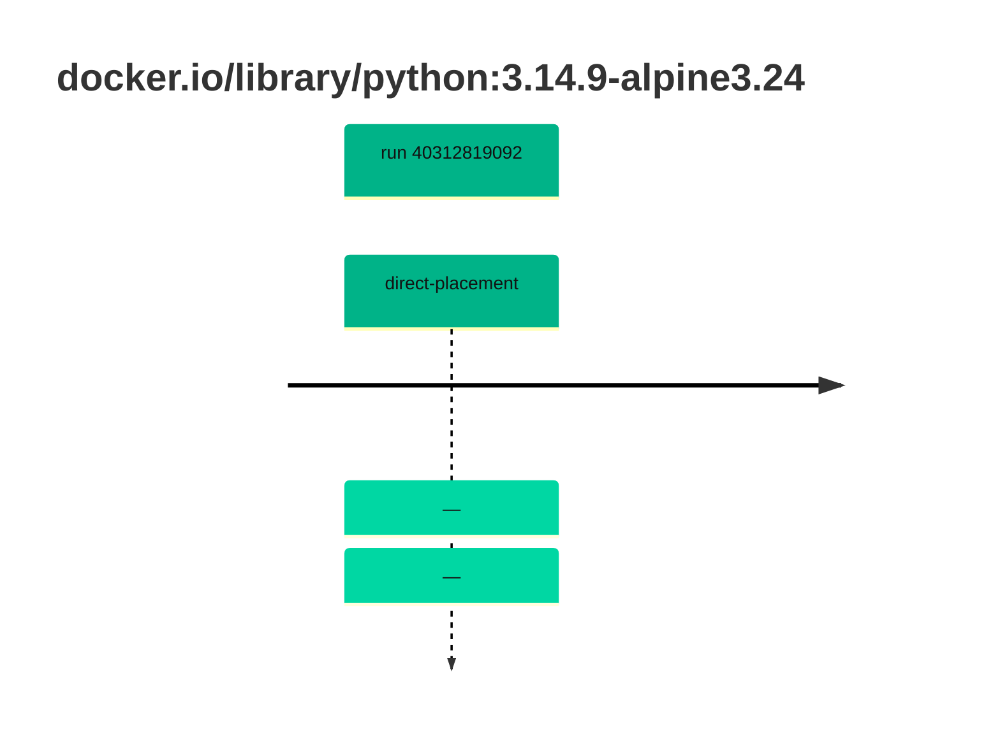

## python-3 · docker.io/library/python:3.14.9-alpine3.24

`sha256:dbeb11d16bb95c3a7e3c25c842cb9f20cbc8c18f8be0461a4a0dcc861ad386a0`

| ts | run | state | reason | ruleset | report | details |
| --- | --- | --- | --- | --- | --- | --- |
| 2026-10-26T11:30:53Z | [40312819092](https://github.com/trivoallan/base-images/actions/runs/40312819092) | direct-placement | — | sha256:7d034c36a6153b33b76e2b2f7b4d84678e9d65039092cf8c67467d573f20ba84 | `results/reports/python-3/sha256:dbeb11d16bb95c3a7e3c25c842cb9f20cbc8c18f8be0461a4a0dcc861ad386a0/40312819092-1.md` |  |
| 2026-10-26T11:32:18Z | [40312819092](https://github.com/trivoallan/base-images/actions/runs/40312819092) | direct-placement | — | sha256:7d034c36a6153b33b76e2b2f7b4d84678e9d65039092cf8c67467d573f20ba84 |  | placed: sha256:8a8306c2db454fc98ea0e2b057ecf82c17ac945625e8bf2ed4814eea2da47da6 |

---

<!-- regis -->
# docker.io/library/python:sha256:dbeb11d16bb95c3a7e3c25c842cb9f20cbc8c18f8be0461a4a0dcc861ad386a0

## 🏷️ Placement direct · 86/100

**6/7 rules · 1 failed · worst: 🟧 warning**

| | Rule | Level | Result |
| --- | --- | --- | --- |
| ✗ | cve-fixable | warning | Image has 2 vulnerabilities with available fixes. |

**Analysis date:** 2026-10-26T11:30:53.118298+00:00

## Playbook results

| Playbook | Verdict | Failing rules |
| --- | --- | --- |
| Image reconstructible | 🏷️ Placement direct · 86/100 | 1 |
