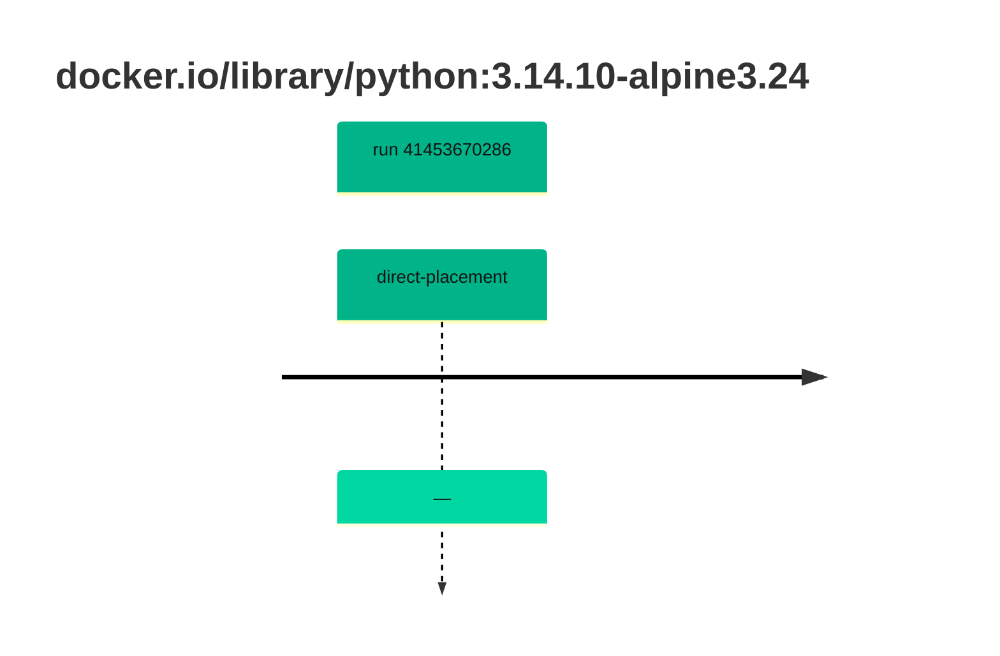

## python-3 · docker.io/library/python:3.14.10-alpine3.24

`sha256:eb2c62658b8d51bff0acc408504b76521d02030de56a8a3c1e830083e89b89d2`

| ts | run | state | reason | ruleset | report | details |
| --- | --- | --- | --- | --- | --- | --- |
| 2026-11-02T13:46:04Z | [41453670286](https://github.com/trivoallan/base-images/actions/runs/41453670286) | direct-placement | — | sha256:7d034c36a6153b33b76e2b2f7b4d84678e9d65039092cf8c67467d573f20ba84 | `results/reports/python-3/sha256:eb2c62658b8d51bff0acc408504b76521d02030de56a8a3c1e830083e89b89d2/41453670286-1.md` |  |

---

<!-- regis -->
# docker.io/library/python:sha256:eb2c62658b8d51bff0acc408504b76521d02030de56a8a3c1e830083e89b89d2

## 🏷️ Placement direct · 86/100

**6/7 rules · 1 failed · worst: 🟧 warning**

| | Rule | Level | Result |
| --- | --- | --- | --- |
| ✗ | cve-fixable | warning | Image has 2 vulnerabilities with available fixes. |

**Analysis date:** 2026-11-02T13:46:03.591132+00:00

## Playbook results

| Playbook | Verdict | Failing rules |
| --- | --- | --- |
| Image reconstructible | 🏷️ Placement direct · 86/100 | 1 |
