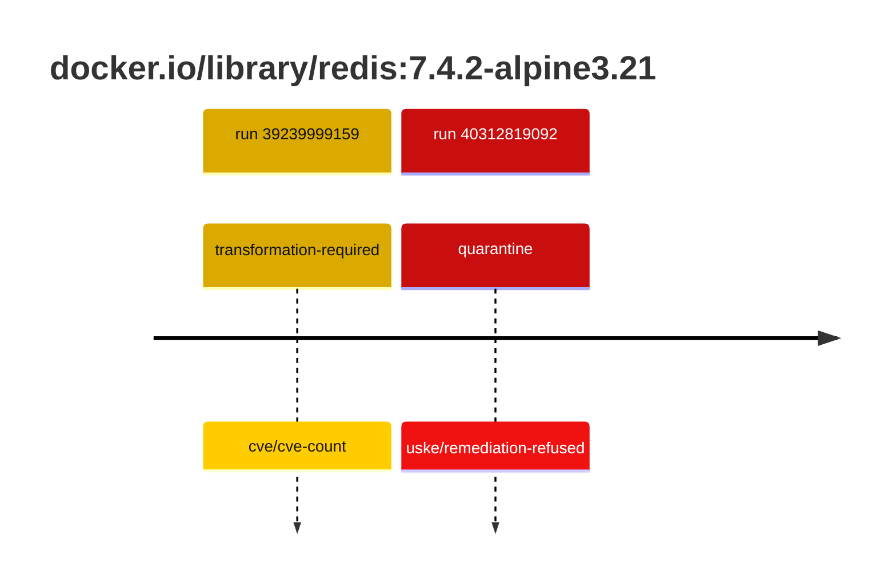
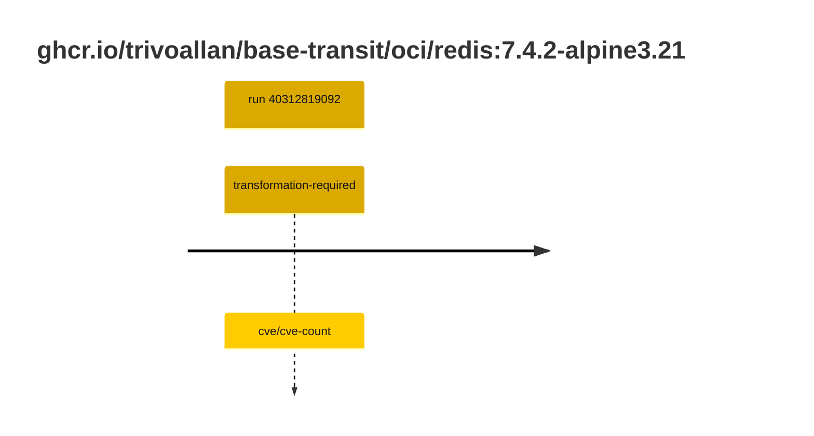

## redis-7 · docker.io/library/redis:7.4.2-alpine3.21

`sha256:02419de7eddf55aa5bcf49efb74e88fa8d931b4d77c07eff8a6b2144472b6952`

| ts | run | state | reason | ruleset | report | details |
| --- | --- | --- | --- | --- | --- | --- |
| 2026-10-19T11:23:46Z | [39239999159](https://github.com/trivoallan/base-images/actions/runs/39239999159) | transformation-required | cve/cve-count | sha256:7d034c36a6153b33b76e2b2f7b4d84678e9d65039092cf8c67467d573f20ba84 | `results/reports/redis-7/sha256:02419de7eddf55aa5bcf49efb74e88fa8d931b4d77c07eff8a6b2144472b6952/39239999159-1.md` | repairable: true |
| 2026-10-26T11:37:30Z | [40312819092](https://github.com/trivoallan/base-images/actions/runs/40312819092) | quarantine | uske/remediation-refused | sha256:7d034c36a6153b33b76e2b2f7b4d84678e9d65039092cf8c67467d573f20ba84 | `results/reports/redis-7/sha256:a24219f511d7f4e14e3b209aac31bb4b2836cdc1c7cc5b99407d83f6eace180e/40312819092-1.md` | rebuilt: sha256:a24219f511d7f4e14e3b209aac31bb4b2836cdc1c7cc5b99407d83f6eace180e |

## redis-7 · ghcr.io/trivoallan/base-transit/oci/redis:7.4.2-alpine3.21

`sha256:a24219f511d7f4e14e3b209aac31bb4b2836cdc1c7cc5b99407d83f6eace180e`

| ts | run | state | reason | ruleset | report | details |
| --- | --- | --- | --- | --- | --- | --- |
| 2026-10-26T11:37:30Z | [40312819092](https://github.com/trivoallan/base-images/actions/runs/40312819092) | transformation-required | cve/cve-count | sha256:7d034c36a6153b33b76e2b2f7b4d84678e9d65039092cf8c67467d573f20ba84 | `results/reports/redis-7/sha256:a24219f511d7f4e14e3b209aac31bb4b2836cdc1c7cc5b99407d83f6eace180e/40312819092-1.md` | source: sha256:02419de7eddf55aa5bcf49efb74e88fa8d931b4d77c07eff8a6b2144472b6952; epoch: 20261026T110911Z |

---

<!-- regis -->
# docker.io/library/redis:sha256:02419de7eddf55aa5bcf49efb74e88fa8d931b4d77c07eff8a6b2144472b6952

## 🏷️ Transformation requise puis placement · 43/100

**3/7 rules · 4 failed · worst: 🟥 critical**

| | Rule | Level | Result |
| --- | --- | --- | --- |
| ✗ | cve-critical | critical | Image has 30 critical CVEs (max allowed: 0). |
| ✗ | cve-fixable | warning | Image has 366 vulnerabilities with available fixes. |
| ✗ | cve-high | warning | Image has 189 high CVEs (max allowed: 10). |
| ✗ | freshness | warning | Image is older than 90 days (650 days). |

**Analysis date:** 2026-10-19T11:23:46.388472+00:00

## Playbook results

| Playbook | Verdict | Failing rules |
| --- | --- | --- |
| Image reconstructible | 🏷️ Transformation requise puis placement · 43/100 | 4 |
