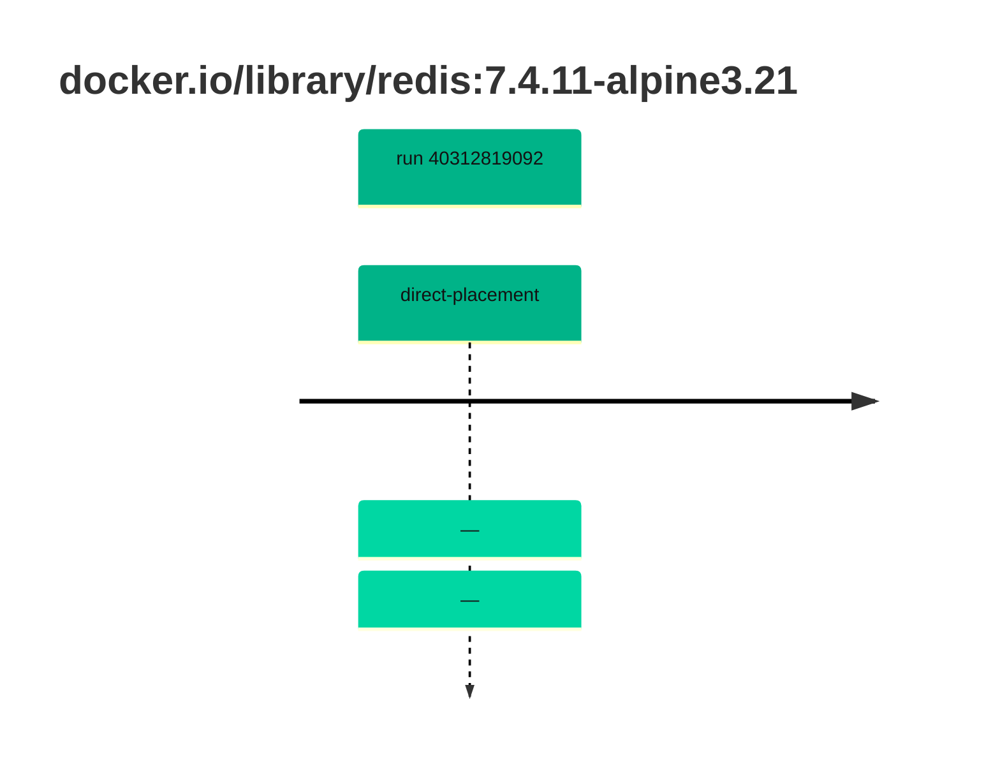

## redis-7 · docker.io/library/redis:7.4.11-alpine3.21

`sha256:57e4255cc971b1c8d6f8a6ca283ac01bc3ecdd914273ef6bfaede87aaecd6541`

| ts | run | state | reason | ruleset | report | details |
| --- | --- | --- | --- | --- | --- | --- |
| 2026-10-26T11:32:58Z | [40312819092](https://github.com/trivoallan/base-images/actions/runs/40312819092) | direct-placement | — | sha256:7d034c36a6153b33b76e2b2f7b4d84678e9d65039092cf8c67467d573f20ba84 | `results/reports/redis-7/sha256:57e4255cc971b1c8d6f8a6ca283ac01bc3ecdd914273ef6bfaede87aaecd6541/40312819092-1.md` |  |
| 2026-10-26T11:36:54Z | [40312819092](https://github.com/trivoallan/base-images/actions/runs/40312819092) | direct-placement | — | sha256:7d034c36a6153b33b76e2b2f7b4d84678e9d65039092cf8c67467d573f20ba84 |  | placed: sha256:798ed512e64eef1d1513cf7e128201969be455240f7618c0858c435390fd6b9a |

---

<!-- regis -->
# docker.io/library/redis:sha256:57e4255cc971b1c8d6f8a6ca283ac01bc3ecdd914273ef6bfaede87aaecd6541

## 🏷️ Placement direct · 100/100

**7/7 rules · all pass ✓**

**Analysis date:** 2026-10-26T11:32:57.463412+00:00

## Playbook results

| Playbook | Verdict | Failing rules |
| --- | --- | --- |
| Image reconstructible | 🏷️ Placement direct · 100/100 | 0 |
