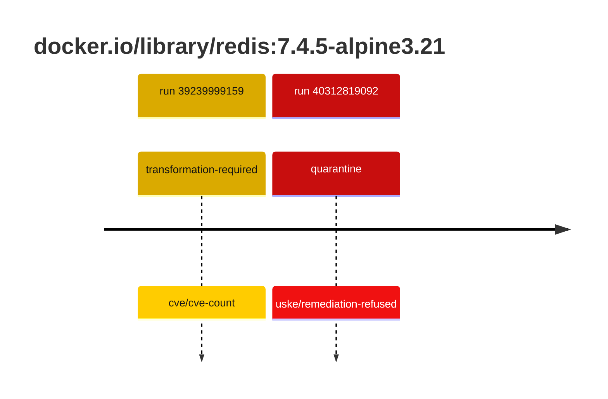
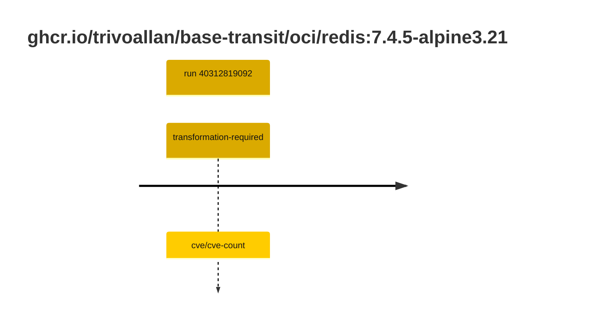

## redis-7 · docker.io/library/redis:7.4.5-alpine3.21

`sha256:bb186d083732f669da90be8b0f975a37812b15e913465bb14d845db72a4e3e08`

| ts | run | state | reason | ruleset | report | details |
| --- | --- | --- | --- | --- | --- | --- |
| 2026-10-19T11:24:20Z | [39239999159](https://github.com/trivoallan/base-images/actions/runs/39239999159) | transformation-required | cve/cve-count | sha256:7d034c36a6153b33b76e2b2f7b4d84678e9d65039092cf8c67467d573f20ba84 | `results/reports/redis-7/sha256:bb186d083732f669da90be8b0f975a37812b15e913465bb14d845db72a4e3e08/39239999159-1.md` | repairable: true |
| 2026-10-26T11:38:23Z | [40312819092](https://github.com/trivoallan/base-images/actions/runs/40312819092) | quarantine | uske/remediation-refused | sha256:7d034c36a6153b33b76e2b2f7b4d84678e9d65039092cf8c67467d573f20ba84 | `results/reports/redis-7/sha256:65b507d524d5eb078a5024043ac0fd44e350baed66ef07c95c5eb829faa967ca/40312819092-1.md` | rebuilt: sha256:65b507d524d5eb078a5024043ac0fd44e350baed66ef07c95c5eb829faa967ca |

## redis-7 · ghcr.io/trivoallan/base-transit/oci/redis:7.4.5-alpine3.21

`sha256:65b507d524d5eb078a5024043ac0fd44e350baed66ef07c95c5eb829faa967ca`

| ts | run | state | reason | ruleset | report | details |
| --- | --- | --- | --- | --- | --- | --- |
| 2026-10-26T11:38:23Z | [40312819092](https://github.com/trivoallan/base-images/actions/runs/40312819092) | transformation-required | cve/cve-count | sha256:7d034c36a6153b33b76e2b2f7b4d84678e9d65039092cf8c67467d573f20ba84 | `results/reports/redis-7/sha256:65b507d524d5eb078a5024043ac0fd44e350baed66ef07c95c5eb829faa967ca/40312819092-1.md` | source: sha256:bb186d083732f669da90be8b0f975a37812b15e913465bb14d845db72a4e3e08; epoch: 20261026T110911Z |

---

<!-- regis -->
# ghcr.io/trivoallan/base-transit/oci/redis:sha256:65b507d524d5eb078a5024043ac0fd44e350baed66ef07c95c5eb829faa967ca

## 🏷️ Transformation requise puis placement · 57/100

**4/7 rules · 3 failed · worst: 🟥 critical**

| | Rule | Level | Result |
| --- | --- | --- | --- |
| ✗ | cve-critical | critical | Image has 19 critical CVEs (max allowed: 0). |
| ✗ | cve-fixable | warning | Image has 267 vulnerabilities with available fixes. |
| ✗ | cve-high | warning | Image has 147 high CVEs (max allowed: 10). |

**Analysis date:** 2026-10-26T11:38:23.165574+00:00

## Playbook results

| Playbook | Verdict | Failing rules |
| --- | --- | --- |
| Image reconstructible | 🏷️ Transformation requise puis placement · 57/100 | 3 |
