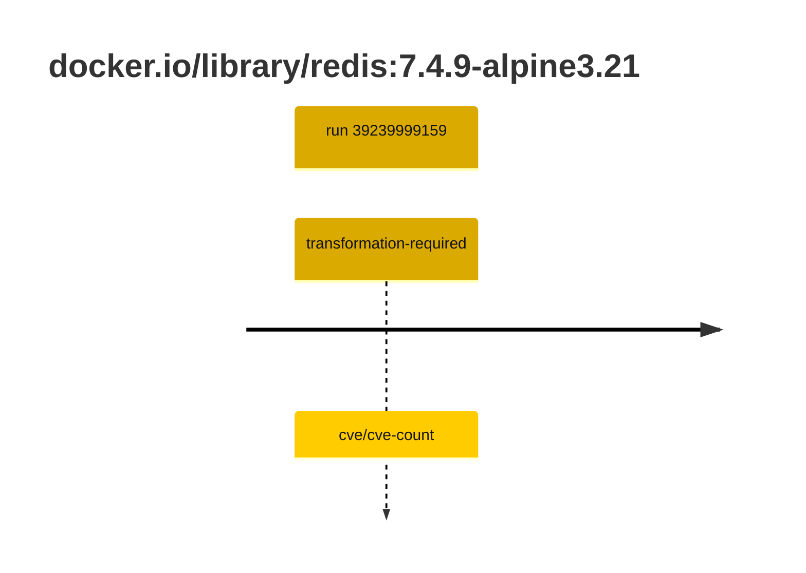
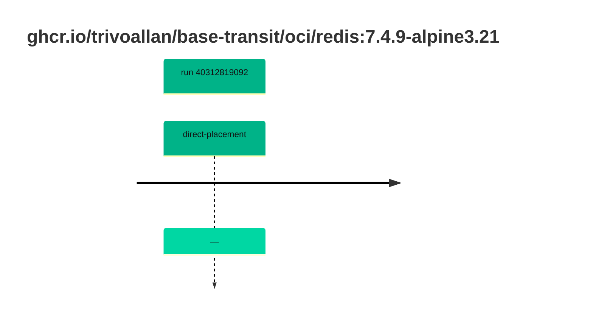

## redis-7 · docker.io/library/redis:7.4.9-alpine3.21

`sha256:6ab0b6e7381779332f97b8ca76193e45b0756f38d4c0dcda72dbb3c32061ab99`

| ts | run | state | reason | ruleset | report | details |
| --- | --- | --- | --- | --- | --- | --- |
| 2026-10-19T11:25:04Z | [39239999159](https://github.com/trivoallan/base-images/actions/runs/39239999159) | transformation-required | cve/cve-count | sha256:7d034c36a6153b33b76e2b2f7b4d84678e9d65039092cf8c67467d573f20ba84 | `results/reports/redis-7/sha256:6ab0b6e7381779332f97b8ca76193e45b0756f38d4c0dcda72dbb3c32061ab99/39239999159-1.md` | repairable: true |

## redis-7 · ghcr.io/trivoallan/base-transit/oci/redis:7.4.9-alpine3.21

`sha256:23cfb018613292e4c215e80867314c3c2b320ecd5bfa4120c0c09d85b114bd78`

| ts | run | state | reason | ruleset | report | details |
| --- | --- | --- | --- | --- | --- | --- |
| 2026-10-26T11:39:35Z | [40312819092](https://github.com/trivoallan/base-images/actions/runs/40312819092) | direct-placement | — | sha256:7d034c36a6153b33b76e2b2f7b4d84678e9d65039092cf8c67467d573f20ba84 | `results/reports/redis-7/sha256:23cfb018613292e4c215e80867314c3c2b320ecd5bfa4120c0c09d85b114bd78/40312819092-1.md` | source: sha256:6ab0b6e7381779332f97b8ca76193e45b0756f38d4c0dcda72dbb3c32061ab99; epoch: 20261026T110911Z |

---

<!-- regis -->
# docker.io/library/redis:sha256:6ab0b6e7381779332f97b8ca76193e45b0756f38d4c0dcda72dbb3c32061ab99

## 🏷️ Transformation requise puis placement · 43/100

**3/7 rules · 4 failed · worst: 🟥 critical**

| | Rule | Level | Result |
| --- | --- | --- | --- |
| ✗ | cve-critical | critical | Image has 6 critical CVEs (max allowed: 0). |
| ✗ | cve-fixable | warning | Image has 47 vulnerabilities with available fixes. |
| ✗ | cve-high | warning | Image has 19 high CVEs (max allowed: 10). |
| ✗ | freshness | warning | Image is older than 90 days (164 days). |

**Analysis date:** 2026-10-19T11:25:04.046634+00:00

## Playbook results

| Playbook | Verdict | Failing rules |
| --- | --- | --- |
| Image reconstructible | 🏷️ Transformation requise puis placement · 43/100 | 4 |
