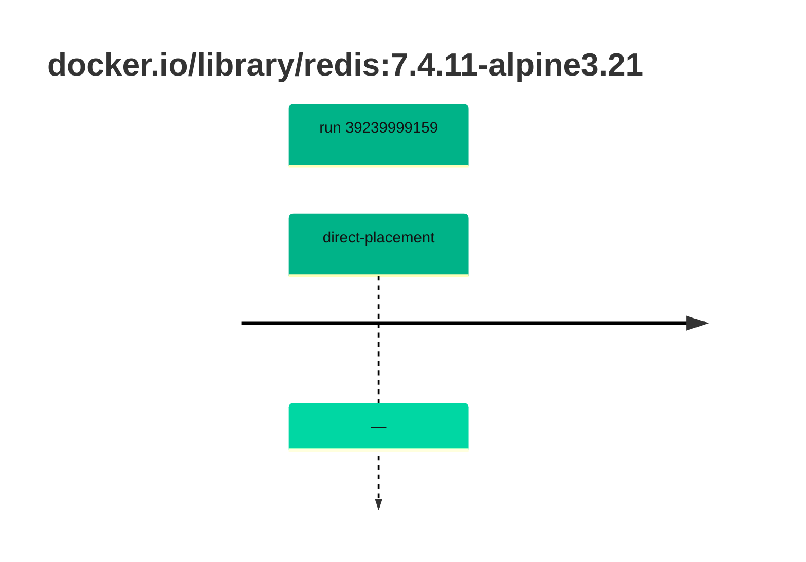

## redis-7 · docker.io/library/redis:7.4.11-alpine3.21

`sha256:858f009f9709ce576febc734aa78b8f6d624b82571f9ddb6bda4377c833b3499`

| ts | run | state | reason | ruleset | report | details |
| --- | --- | --- | --- | --- | --- | --- |
| 2026-10-19T11:25:54Z | [39239999159](https://github.com/trivoallan/base-images/actions/runs/39239999159) | direct-placement | — | sha256:7d034c36a6153b33b76e2b2f7b4d84678e9d65039092cf8c67467d573f20ba84 | `results/reports/redis-7/sha256:858f009f9709ce576febc734aa78b8f6d624b82571f9ddb6bda4377c833b3499/39239999159-1.md` |  |

---

<!-- regis -->
# docker.io/library/redis:sha256:858f009f9709ce576febc734aa78b8f6d624b82571f9ddb6bda4377c833b3499

## 🏷️ Placement direct · 86/100

**6/7 rules · 1 failed · worst: 🟧 warning**

| | Rule | Level | Result |
| --- | --- | --- | --- |
| ✗ | cve-fixable | warning | Image has 21 vulnerabilities with available fixes. |

**Analysis date:** 2026-10-19T11:25:53.696064+00:00

## Playbook results

| Playbook | Verdict | Failing rules |
| --- | --- | --- |
| Image reconstructible | 🏷️ Placement direct · 86/100 | 1 |
