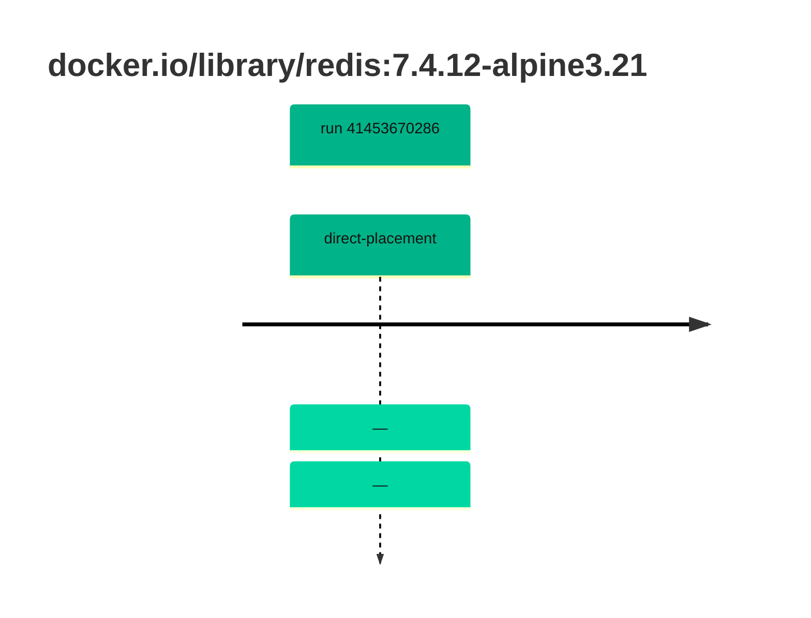

## redis-7 · docker.io/library/redis:7.4.12-alpine3.21

`sha256:8da19c7399dca900c6822a1cf30f9d2285585e2c4b457ff4095b0f4500054d3f`

| ts | run | state | reason | ruleset | report | details |
| --- | --- | --- | --- | --- | --- | --- |
| 2026-11-02T13:49:57Z | [41453670286](https://github.com/trivoallan/base-images/actions/runs/41453670286) | direct-placement | — | sha256:7d034c36a6153b33b76e2b2f7b4d84678e9d65039092cf8c67467d573f20ba84 | `results/reports/redis-7/sha256:8da19c7399dca900c6822a1cf30f9d2285585e2c4b457ff4095b0f4500054d3f/41453670286-1.md` |  |
| 2026-11-02T13:52:38Z | [41453670286](https://github.com/trivoallan/base-images/actions/runs/41453670286) | direct-placement | — | sha256:7d034c36a6153b33b76e2b2f7b4d84678e9d65039092cf8c67467d573f20ba84 |  | placed: sha256:2e522f5768db01bc554b90102055420c9f9e5889288a97c6f093cd45750f8d63 |

---

<!-- regis -->
# docker.io/library/redis:sha256:8da19c7399dca900c6822a1cf30f9d2285585e2c4b457ff4095b0f4500054d3f

## 🏷️ Placement direct · 100/100

**7/7 rules · all pass ✓**

**Analysis date:** 2026-11-02T13:49:56.692143+00:00

## Playbook results

| Playbook | Verdict | Failing rules |
| --- | --- | --- |
| Image reconstructible | 🏷️ Placement direct · 100/100 | 0 |
