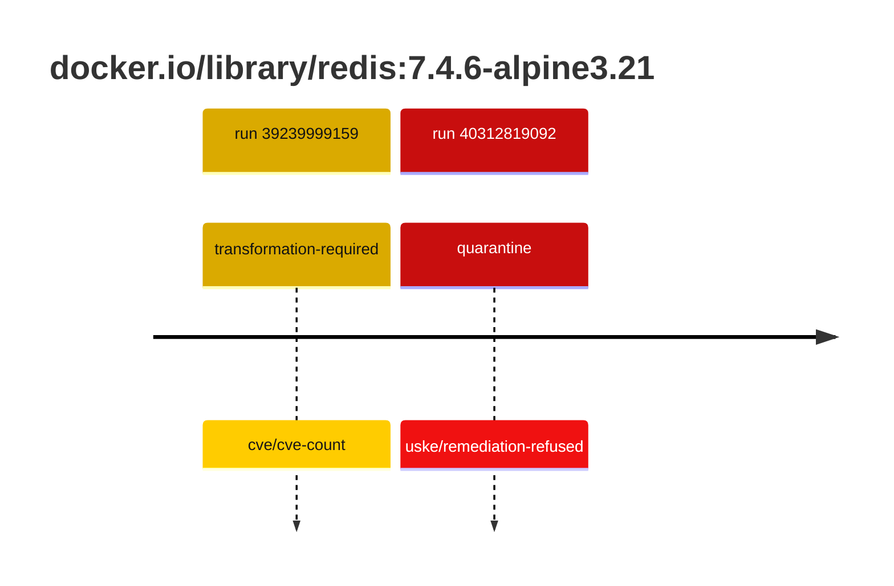
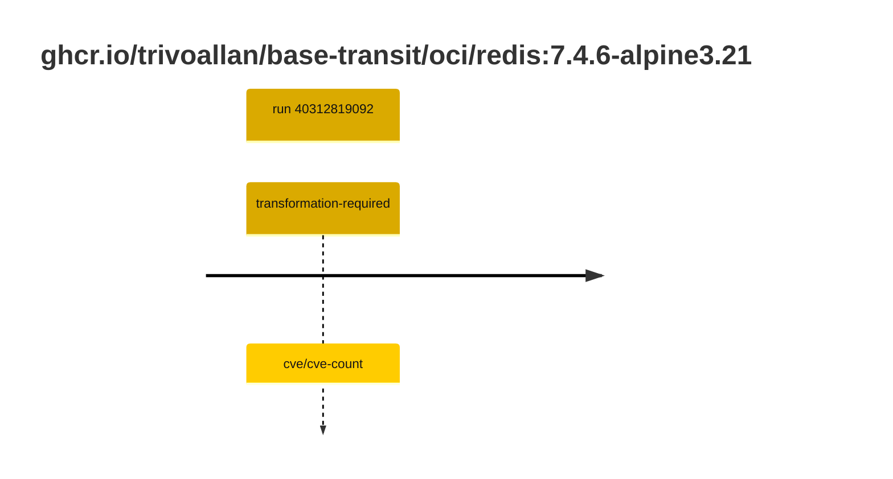

## redis-7 · docker.io/library/redis:7.4.6-alpine3.21

`sha256:3b73847e72874be07e6657b129a94761662b79bc0f679273757d4218573b2a98`

| ts | run | state | reason | ruleset | report | details |
| --- | --- | --- | --- | --- | --- | --- |
| 2026-10-19T11:24:31Z | [39239999159](https://github.com/trivoallan/base-images/actions/runs/39239999159) | transformation-required | cve/cve-count | sha256:7d034c36a6153b33b76e2b2f7b4d84678e9d65039092cf8c67467d573f20ba84 | `results/reports/redis-7/sha256:3b73847e72874be07e6657b129a94761662b79bc0f679273757d4218573b2a98/39239999159-1.md` | repairable: true |
| 2026-10-26T11:38:41Z | [40312819092](https://github.com/trivoallan/base-images/actions/runs/40312819092) | quarantine | uske/remediation-refused | sha256:7d034c36a6153b33b76e2b2f7b4d84678e9d65039092cf8c67467d573f20ba84 | `results/reports/redis-7/sha256:9f83bf38f2dd6640297329cee79623f7729fbaf85758eb267bd246fa209bcc97/40312819092-1.md` | rebuilt: sha256:9f83bf38f2dd6640297329cee79623f7729fbaf85758eb267bd246fa209bcc97 |

## redis-7 · ghcr.io/trivoallan/base-transit/oci/redis:7.4.6-alpine3.21

`sha256:9f83bf38f2dd6640297329cee79623f7729fbaf85758eb267bd246fa209bcc97`

| ts | run | state | reason | ruleset | report | details |
| --- | --- | --- | --- | --- | --- | --- |
| 2026-10-26T11:38:41Z | [40312819092](https://github.com/trivoallan/base-images/actions/runs/40312819092) | transformation-required | cve/cve-count | sha256:7d034c36a6153b33b76e2b2f7b4d84678e9d65039092cf8c67467d573f20ba84 | `results/reports/redis-7/sha256:9f83bf38f2dd6640297329cee79623f7729fbaf85758eb267bd246fa209bcc97/40312819092-1.md` | source: sha256:3b73847e72874be07e6657b129a94761662b79bc0f679273757d4218573b2a98; epoch: 20261026T110911Z |

---

<!-- regis -->
# ghcr.io/trivoallan/base-transit/oci/redis:sha256:9f83bf38f2dd6640297329cee79623f7729fbaf85758eb267bd246fa209bcc97

## 🏷️ Transformation requise puis placement · 57/100

**4/7 rules · 3 failed · worst: 🟥 critical**

| | Rule | Level | Result |
| --- | --- | --- | --- |
| ✗ | cve-critical | critical | Image has 18 critical CVEs (max allowed: 0). |
| ✗ | cve-fixable | warning | Image has 263 vulnerabilities with available fixes. |
| ✗ | cve-high | warning | Image has 144 high CVEs (max allowed: 10). |

**Analysis date:** 2026-10-26T11:38:40.773882+00:00

## Playbook results

| Playbook | Verdict | Failing rules |
| --- | --- | --- |
| Image reconstructible | 🏷️ Transformation requise puis placement · 57/100 | 3 |
