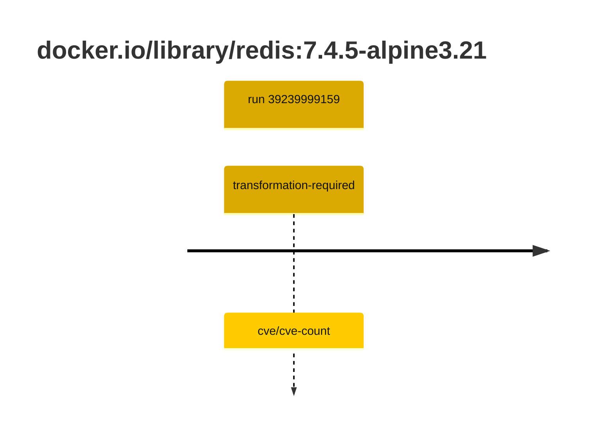

## redis-7 · docker.io/library/redis:7.4.5-alpine3.21

`sha256:bb186d083732f669da90be8b0f975a37812b15e913465bb14d845db72a4e3e08`

| ts | run | state | reason | ruleset | report | details |
| --- | --- | --- | --- | --- | --- | --- |
| 2026-10-19T11:24:20Z | [39239999159](https://github.com/trivoallan/base-images/actions/runs/39239999159) | transformation-required | cve/cve-count | sha256:7d034c36a6153b33b76e2b2f7b4d84678e9d65039092cf8c67467d573f20ba84 | `results/reports/redis-7/sha256:bb186d083732f669da90be8b0f975a37812b15e913465bb14d845db72a4e3e08/39239999159-1.md` | repairable: true |

---

<!-- regis -->
# docker.io/library/redis:sha256:bb186d083732f669da90be8b0f975a37812b15e913465bb14d845db72a4e3e08

## 🏷️ Transformation requise puis placement · 43/100

**3/7 rules · 4 failed · worst: 🟥 critical**

| | Rule | Level | Result |
| --- | --- | --- | --- |
| ✗ | cve-critical | critical | Image has 29 critical CVEs (max allowed: 0). |
| ✗ | cve-fixable | warning | Image has 362 vulnerabilities with available fixes. |
| ✗ | cve-high | warning | Image has 186 high CVEs (max allowed: 10). |
| ✗ | freshness | warning | Image is older than 90 days (469 days). |

**Analysis date:** 2026-10-19T11:24:20.232639+00:00

## Playbook results

| Playbook | Verdict | Failing rules |
| --- | --- | --- |
| Image reconstructible | 🏷️ Transformation requise puis placement · 43/100 | 4 |
