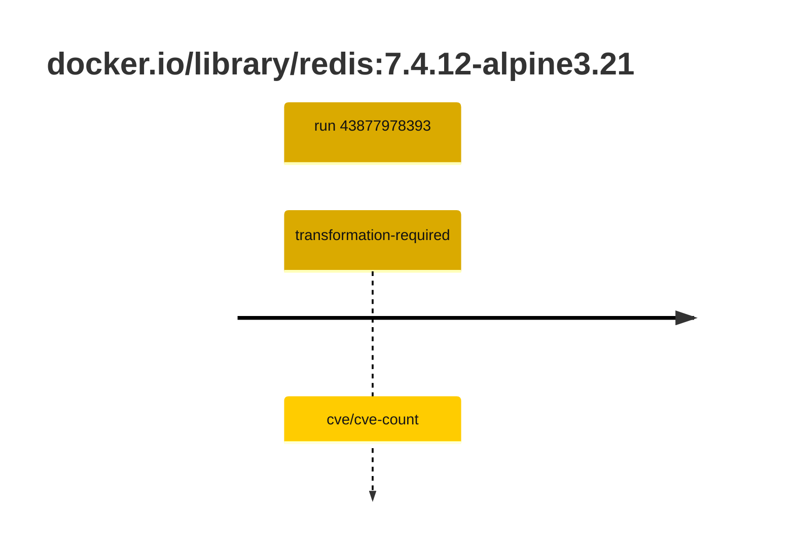

## redis-7 · docker.io/library/redis:7.4.12-alpine3.21

`sha256:c5d34a98396a4775e223c74e929162c35c5a2182901ba26b50ade939941ce14b`

| ts | run | state | reason | ruleset | report | details |
| --- | --- | --- | --- | --- | --- | --- |
| 2026-11-16T13:58:13Z | [43877978393](https://github.com/trivoallan/base-images/actions/runs/43877978393) | transformation-required | cve/cve-count | sha256:7d034c36a6153b33b76e2b2f7b4d84678e9d65039092cf8c67467d573f20ba84 | `results/reports/redis-7/sha256:c5d34a98396a4775e223c74e929162c35c5a2182901ba26b50ade939941ce14b/43877978393-1.md` | repairable: true |

---

<!-- regis -->
# docker.io/library/redis:sha256:c5d34a98396a4775e223c74e929162c35c5a2182901ba26b50ade939941ce14b

## 🏷️ Transformation requise puis placement · 71/100

**5/7 rules · 2 failed · worst: 🟥 critical**

| | Rule | Level | Result |
| --- | --- | --- | --- |
| ✗ | cve-critical | critical | Image has 1 critical CVEs (max allowed: 0). |
| ✗ | cve-fixable | warning | Image has 1 vulnerabilities with available fixes. |

**Analysis date:** 2026-11-16T13:58:12.918324+00:00

## Playbook results

| Playbook | Verdict | Failing rules |
| --- | --- | --- |
| Image reconstructible | 🏷️ Transformation requise puis placement · 71/100 | 2 |
