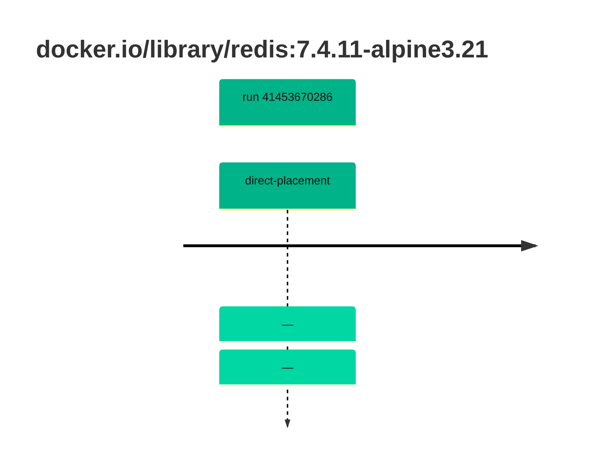

## redis-7 · docker.io/library/redis:7.4.11-alpine3.21

`sha256:d9436322172a5b482c187bf1f363d3c4fea086fcca6b9c8a94de8f0f39ed3193`

| ts | run | state | reason | ruleset | report | details |
| --- | --- | --- | --- | --- | --- | --- |
| 2026-11-02T13:50:14Z | [41453670286](https://github.com/trivoallan/base-images/actions/runs/41453670286) | direct-placement | — | sha256:7d034c36a6153b33b76e2b2f7b4d84678e9d65039092cf8c67467d573f20ba84 | `results/reports/redis-7/sha256:d9436322172a5b482c187bf1f363d3c4fea086fcca6b9c8a94de8f0f39ed3193/41453670286-1.md` |  |
| 2026-11-02T13:52:38Z | [41453670286](https://github.com/trivoallan/base-images/actions/runs/41453670286) | direct-placement | — | sha256:7d034c36a6153b33b76e2b2f7b4d84678e9d65039092cf8c67467d573f20ba84 |  | placed: sha256:6e9eb6968c896bdfd4bad54535f6ecd9e16bbb1161667de226681703c8832d6b |

---

<!-- regis -->
# docker.io/library/redis:sha256:d9436322172a5b482c187bf1f363d3c4fea086fcca6b9c8a94de8f0f39ed3193

## 🏷️ Placement direct · 100/100

**7/7 rules · all pass ✓**

**Analysis date:** 2026-11-02T13:50:13.231416+00:00

## Playbook results

| Playbook | Verdict | Failing rules |
| --- | --- | --- |
| Image reconstructible | 🏷️ Placement direct · 100/100 | 0 |
