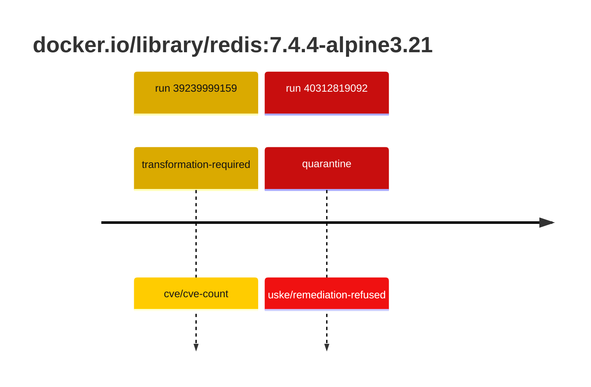
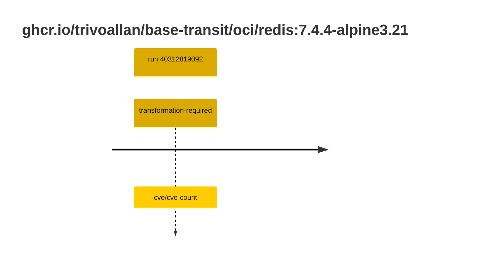

## redis-7 · docker.io/library/redis:7.4.4-alpine3.21

`sha256:ee9e8748ace004102a267f7b8265dab2c618317df22507b89d16a8add7154273`

| ts | run | state | reason | ruleset | report | details |
| --- | --- | --- | --- | --- | --- | --- |
| 2026-10-19T11:24:09Z | [39239999159](https://github.com/trivoallan/base-images/actions/runs/39239999159) | transformation-required | cve/cve-count | sha256:7d034c36a6153b33b76e2b2f7b4d84678e9d65039092cf8c67467d573f20ba84 | `results/reports/redis-7/sha256:ee9e8748ace004102a267f7b8265dab2c618317df22507b89d16a8add7154273/39239999159-1.md` | repairable: true |
| 2026-10-26T11:38:06Z | [40312819092](https://github.com/trivoallan/base-images/actions/runs/40312819092) | quarantine | uske/remediation-refused | sha256:7d034c36a6153b33b76e2b2f7b4d84678e9d65039092cf8c67467d573f20ba84 | `results/reports/redis-7/sha256:ee36b2331486ffbfecd7b25a244d9238635e304a79cf8af1c8152553ab35ca6f/40312819092-1.md` | rebuilt: sha256:ee36b2331486ffbfecd7b25a244d9238635e304a79cf8af1c8152553ab35ca6f |

## redis-7 · ghcr.io/trivoallan/base-transit/oci/redis:7.4.4-alpine3.21

`sha256:ee36b2331486ffbfecd7b25a244d9238635e304a79cf8af1c8152553ab35ca6f`

| ts | run | state | reason | ruleset | report | details |
| --- | --- | --- | --- | --- | --- | --- |
| 2026-10-26T11:38:06Z | [40312819092](https://github.com/trivoallan/base-images/actions/runs/40312819092) | transformation-required | cve/cve-count | sha256:7d034c36a6153b33b76e2b2f7b4d84678e9d65039092cf8c67467d573f20ba84 | `results/reports/redis-7/sha256:ee36b2331486ffbfecd7b25a244d9238635e304a79cf8af1c8152553ab35ca6f/40312819092-1.md` | source: sha256:ee9e8748ace004102a267f7b8265dab2c618317df22507b89d16a8add7154273; epoch: 20261026T110911Z |

---

<!-- regis -->
# ghcr.io/trivoallan/base-transit/oci/redis:sha256:ee36b2331486ffbfecd7b25a244d9238635e304a79cf8af1c8152553ab35ca6f

## 🏷️ Transformation requise puis placement · 57/100

**4/7 rules · 3 failed · worst: 🟥 critical**

| | Rule | Level | Result |
| --- | --- | --- | --- |
| ✗ | cve-critical | critical | Image has 19 critical CVEs (max allowed: 0). |
| ✗ | cve-fixable | warning | Image has 269 vulnerabilities with available fixes. |
| ✗ | cve-high | warning | Image has 149 high CVEs (max allowed: 10). |

**Analysis date:** 2026-10-26T11:38:05.388596+00:00

## Playbook results

| Playbook | Verdict | Failing rules |
| --- | --- | --- |
| Image reconstructible | 🏷️ Transformation requise puis placement · 57/100 | 3 |
