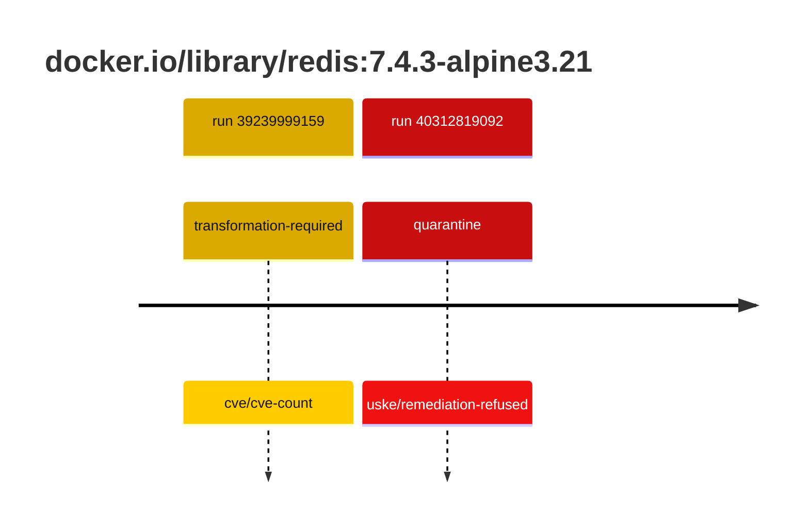
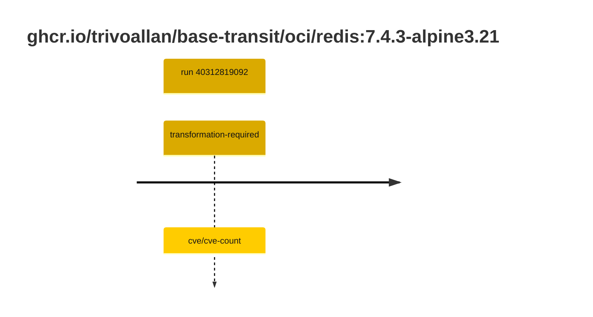

## redis-7 · docker.io/library/redis:7.4.3-alpine3.21

`sha256:f773b35a95e170d92dd4214a3ec4859b1b7960bf56896ae687646d695f311187`

| ts | run | state | reason | ruleset | report | details |
| --- | --- | --- | --- | --- | --- | --- |
| 2026-10-19T11:23:58Z | [39239999159](https://github.com/trivoallan/base-images/actions/runs/39239999159) | transformation-required | cve/cve-count | sha256:7d034c36a6153b33b76e2b2f7b4d84678e9d65039092cf8c67467d573f20ba84 | `results/reports/redis-7/sha256:f773b35a95e170d92dd4214a3ec4859b1b7960bf56896ae687646d695f311187/39239999159-1.md` | repairable: true |
| 2026-10-26T11:37:48Z | [40312819092](https://github.com/trivoallan/base-images/actions/runs/40312819092) | quarantine | uske/remediation-refused | sha256:7d034c36a6153b33b76e2b2f7b4d84678e9d65039092cf8c67467d573f20ba84 | `results/reports/redis-7/sha256:c50e2eec12e3d882049e09975b7340b76a8ff0f4da2ed43f1a74d12f713f51b9/40312819092-1.md` | rebuilt: sha256:c50e2eec12e3d882049e09975b7340b76a8ff0f4da2ed43f1a74d12f713f51b9 |

## redis-7 · ghcr.io/trivoallan/base-transit/oci/redis:7.4.3-alpine3.21

`sha256:c50e2eec12e3d882049e09975b7340b76a8ff0f4da2ed43f1a74d12f713f51b9`

| ts | run | state | reason | ruleset | report | details |
| --- | --- | --- | --- | --- | --- | --- |
| 2026-10-26T11:37:48Z | [40312819092](https://github.com/trivoallan/base-images/actions/runs/40312819092) | transformation-required | cve/cve-count | sha256:7d034c36a6153b33b76e2b2f7b4d84678e9d65039092cf8c67467d573f20ba84 | `results/reports/redis-7/sha256:c50e2eec12e3d882049e09975b7340b76a8ff0f4da2ed43f1a74d12f713f51b9/40312819092-1.md` | source: sha256:f773b35a95e170d92dd4214a3ec4859b1b7960bf56896ae687646d695f311187; epoch: 20261026T110911Z |

---

<!-- regis -->
# docker.io/library/redis:sha256:f773b35a95e170d92dd4214a3ec4859b1b7960bf56896ae687646d695f311187

## 🏷️ Transformation requise puis placement · 43/100

**3/7 rules · 4 failed · worst: 🟥 critical**

| | Rule | Level | Result |
| --- | --- | --- | --- |
| ✗ | cve-critical | critical | Image has 30 critical CVEs (max allowed: 0). |
| ✗ | cve-fixable | warning | Image has 365 vulnerabilities with available fixes. |
| ✗ | cve-high | warning | Image has 188 high CVEs (max allowed: 10). |
| ✗ | freshness | warning | Image is older than 90 days (543 days). |

**Analysis date:** 2026-10-19T11:23:57.970465+00:00

## Playbook results

| Playbook | Verdict | Failing rules |
| --- | --- | --- |
| Image reconstructible | 🏷️ Transformation requise puis placement · 43/100 | 4 |
