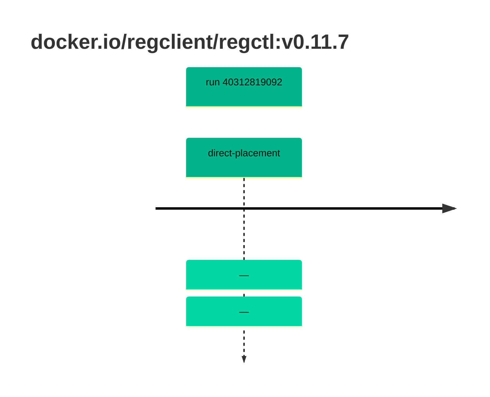

## regctl-0 · docker.io/regclient/regctl:v0.11.7

`sha256:45b57933c2b67bb1e280b4baaa220ef1ab212c81268ab19589fa1e83719c7c82`

| ts | run | state | reason | ruleset | report | details |
| --- | --- | --- | --- | --- | --- | --- |
| 2026-10-26T11:14:37Z | [40312819092](https://github.com/trivoallan/base-images/actions/runs/40312819092) | direct-placement | — | sha256:0936ffb81cdaa3596af399bfa54a5c6b9171416996ea31b39bc77dab6a8c1585 | `results/reports/regctl-0/sha256:45b57933c2b67bb1e280b4baaa220ef1ab212c81268ab19589fa1e83719c7c82/40312819092-1.md` |  |
| 2026-10-26T11:15:55Z | [40312819092](https://github.com/trivoallan/base-images/actions/runs/40312819092) | direct-placement | — | sha256:0936ffb81cdaa3596af399bfa54a5c6b9171416996ea31b39bc77dab6a8c1585 |  | placed: sha256:b0646ce53cf30591f3963abf66691a5f567c071890cccc982427e619f01722aa |

---

<!-- regis -->
# docker.io/regclient/regctl:sha256:45b57933c2b67bb1e280b4baaa220ef1ab212c81268ab19589fa1e83719c7c82

## 🏷️ Placement direct · 100/100

**6/6 rules · all pass ✓**

**Analysis date:** 2026-10-26T11:14:36.597684+00:00

## Playbook results

| Playbook | Verdict | Failing rules |
| --- | --- | --- |
| Image copiée | 🏷️ Placement direct · 100/100 | 0 |
