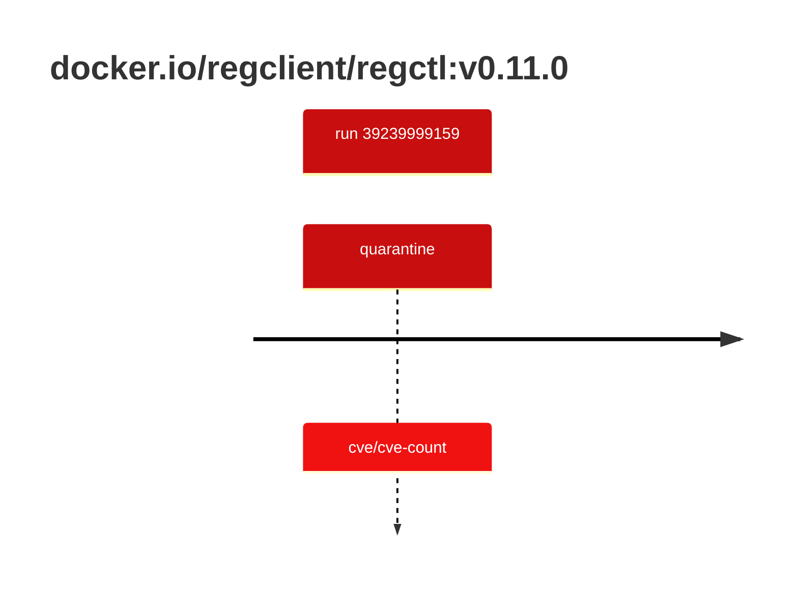

## regctl-0 · docker.io/regclient/regctl:v0.11.0

`sha256:85c2b62eef4c196736b9303c899755dc23c45775fb5fbcf5378535cf7000e078`

| ts | run | state | reason | ruleset | report | details |
| --- | --- | --- | --- | --- | --- | --- |
| 2026-10-19T10:57:06Z | [39239999159](https://github.com/trivoallan/base-images/actions/runs/39239999159) | quarantine | cve/cve-count | sha256:0936ffb81cdaa3596af399bfa54a5c6b9171416996ea31b39bc77dab6a8c1585 | `results/reports/regctl-0/sha256:85c2b62eef4c196736b9303c899755dc23c45775fb5fbcf5378535cf7000e078/39239999159-1.md` |  |

---

<!-- regis -->
# docker.io/regclient/regctl:sha256:85c2b62eef4c196736b9303c899755dc23c45775fb5fbcf5378535cf7000e078

## 🏷️ Quarantaine · 50/100

**3/6 rules · 3 failed · worst: 🟥 critical**

| | Rule | Level | Result |
| --- | --- | --- | --- |
| ✗ | cve-critical | critical | Image has 7 critical CVEs (max allowed: 0). |
| ✗ | cve-high | warning | Image has 66 high CVEs (max allowed: 10). |
| ✗ | freshness | warning | Image is older than 90 days (321 days). |

**Analysis date:** 2026-10-19T10:57:05.789487+00:00

## Playbook results

| Playbook | Verdict | Failing rules |
| --- | --- | --- |
| Image copiée | 🏷️ Quarantaine · 50/100 | 3 |
