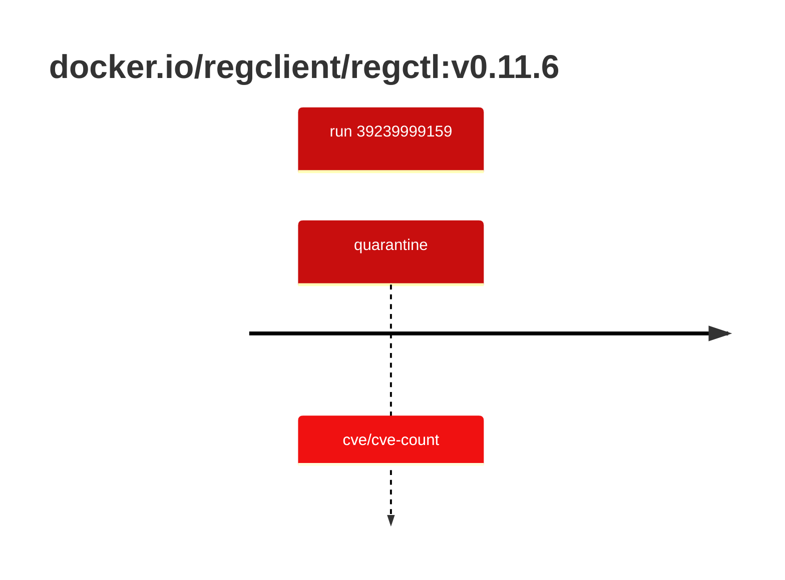

## regctl-0 · docker.io/regclient/regctl:v0.11.6

`sha256:db2e5f3a5de80b24d53fea5af9edf7021a53f2689f1e166ef2f0e200dad4fb3a`

| ts | run | state | reason | ruleset | report | details |
| --- | --- | --- | --- | --- | --- | --- |
| 2026-10-19T10:58:34Z | [39239999159](https://github.com/trivoallan/base-images/actions/runs/39239999159) | quarantine | cve/cve-count | sha256:0936ffb81cdaa3596af399bfa54a5c6b9171416996ea31b39bc77dab6a8c1585 | `results/reports/regctl-0/sha256:db2e5f3a5de80b24d53fea5af9edf7021a53f2689f1e166ef2f0e200dad4fb3a/39239999159-1.md` |  |

---

<!-- regis -->
# docker.io/regclient/regctl:sha256:db2e5f3a5de80b24d53fea5af9edf7021a53f2689f1e166ef2f0e200dad4fb3a

## 🏷️ Quarantaine · 67/100

**4/6 rules · 2 failed · worst: 🟥 critical**

| | Rule | Level | Result |
| --- | --- | --- | --- |
| ✗ | cve-critical | critical | Image has 4 critical CVEs (max allowed: 0). |
| ✗ | cve-high | warning | Image has 20 high CVEs (max allowed: 10). |

**Analysis date:** 2026-10-19T10:58:33.803573+00:00

## Playbook results

| Playbook | Verdict | Failing rules |
| --- | --- | --- |
| Image copiée | 🏷️ Quarantaine · 67/100 | 2 |
