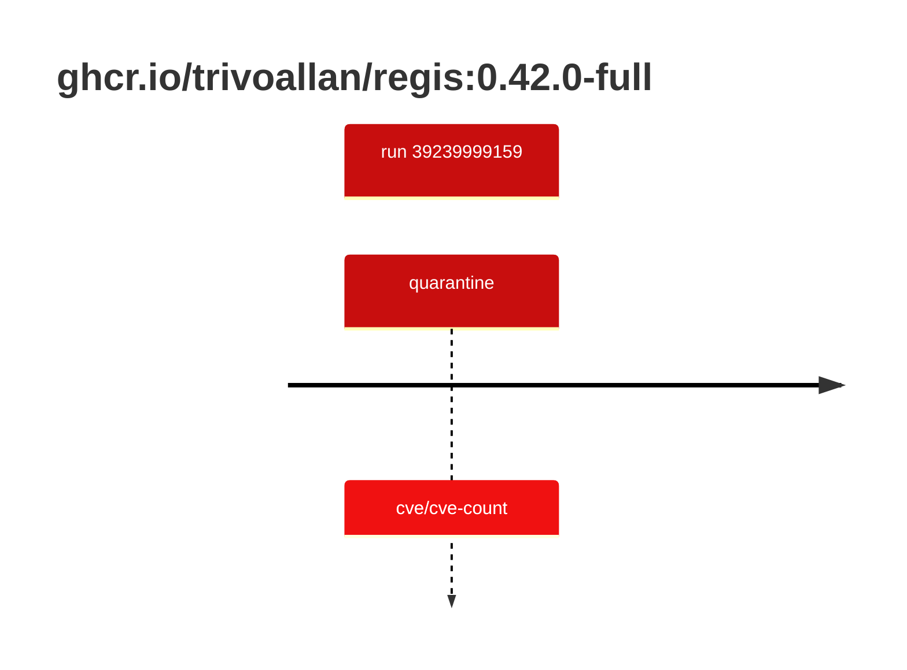

## regis-0 · ghcr.io/trivoallan/regis:0.42.0-full

`sha256:c933471fedf0d6669c6757a4d9bd208acad5e295e827a426bbda631eb13f05ec`

| ts | run | state | reason | ruleset | report | details |
| --- | --- | --- | --- | --- | --- | --- |
| 2026-10-19T11:08:47Z | [39239999159](https://github.com/trivoallan/base-images/actions/runs/39239999159) | quarantine | cve/cve-count | sha256:8ce5b54c72fa885fd71dc09af6d32f3e1703dba2d02a1288fca31f3d8f4ec469 | `results/reports/regis-0/sha256:c933471fedf0d6669c6757a4d9bd208acad5e295e827a426bbda631eb13f05ec/39239999159-1.md` |  |

---

<!-- regis -->
# ghcr.io/trivoallan/regis:sha256:c933471fedf0d6669c6757a4d9bd208acad5e295e827a426bbda631eb13f05ec

## 🏷️ Quarantaine · 71/100

**5/7 rules · 2 failed · worst: 🟥 critical**

| | Rule | Level | Result |
| --- | --- | --- | --- |
| ✗ | cve-critical | critical | Image has 34 critical CVEs (max allowed: 0). |
| ✗ | cve-high | warning | Image has 285 high CVEs (max allowed: 10). |

**Analysis date:** 2026-10-19T11:08:46.542713+00:00

## Playbook results

| Playbook | Verdict | Failing rules |
| --- | --- | --- |
| Outil maison | 🏷️ Quarantaine · 71/100 | 2 |
