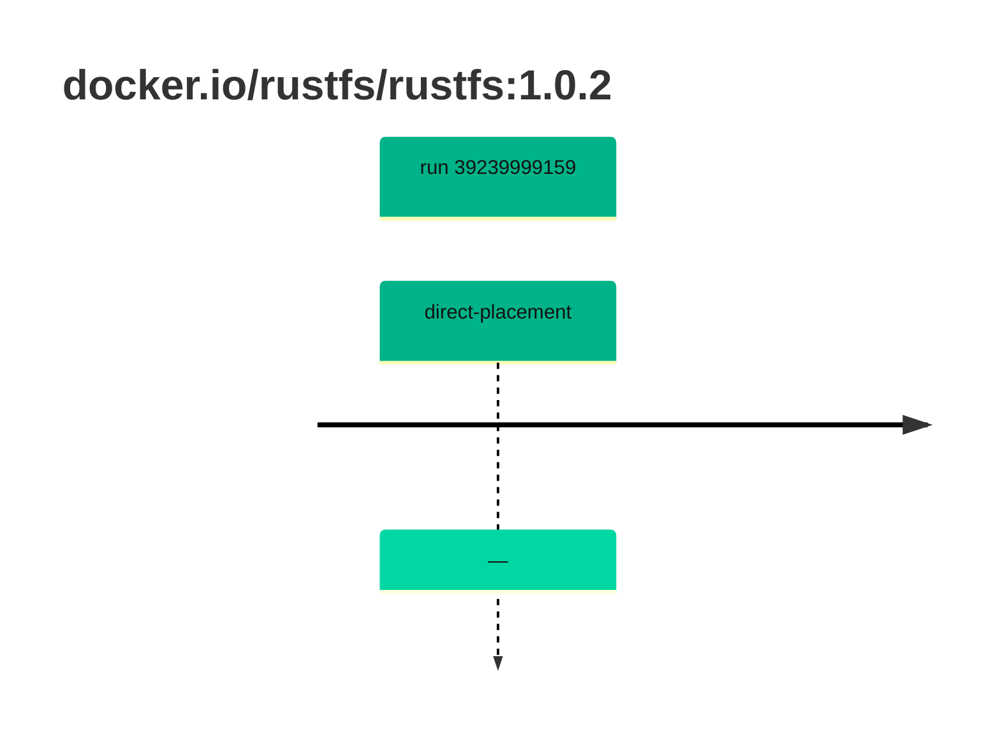

## rustfs-1 · docker.io/rustfs/rustfs:1.0.2

`sha256:7e948dad4748bda48f8985fda7195f8cf2e4259427011f6120acc2c9acf51587`

| ts | run | state | reason | ruleset | report | details |
| --- | --- | --- | --- | --- | --- | --- |
| 2026-10-19T10:59:22Z | [39239999159](https://github.com/trivoallan/base-images/actions/runs/39239999159) | direct-placement | — | sha256:0936ffb81cdaa3596af399bfa54a5c6b9171416996ea31b39bc77dab6a8c1585 | `results/reports/rustfs-1/sha256:7e948dad4748bda48f8985fda7195f8cf2e4259427011f6120acc2c9acf51587/39239999159-1.md` |  |

---

<!-- regis -->
# docker.io/rustfs/rustfs:sha256:7e948dad4748bda48f8985fda7195f8cf2e4259427011f6120acc2c9acf51587

## 🏷️ Placement direct · 100/100

**6/6 rules · all pass ✓**

**Analysis date:** 2026-10-19T10:59:21.483688+00:00

## Playbook results

| Playbook | Verdict | Failing rules |
| --- | --- | --- |
| Image copiée | 🏷️ Placement direct · 100/100 | 0 |
