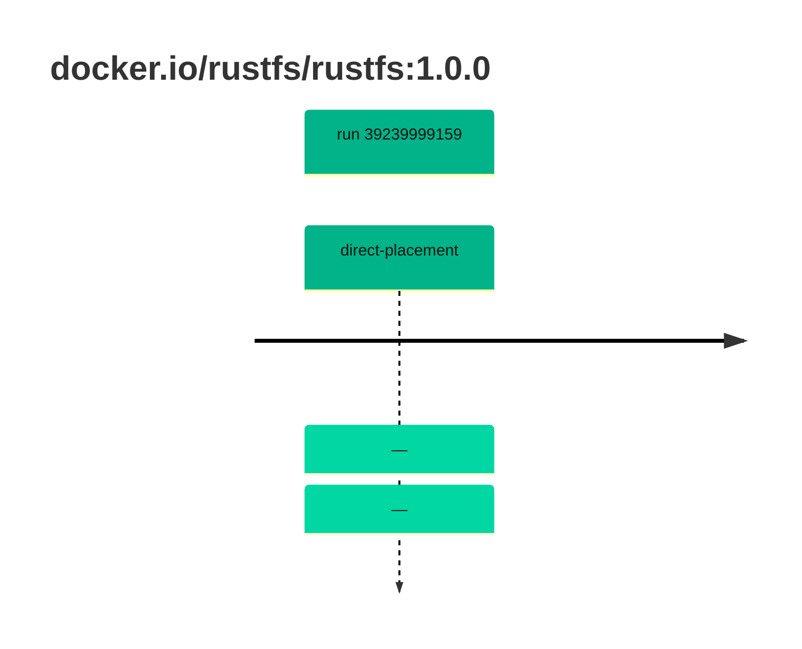

## rustfs-1 · docker.io/rustfs/rustfs:1.0.0

`sha256:8cc9801755448b71a786705ce76692c77e14936cccd87cf2fc31842e58f4d1ff`

| ts | run | state | reason | ruleset | report | details |
| --- | --- | --- | --- | --- | --- | --- |
| 2026-10-19T10:58:58Z | [39239999159](https://github.com/trivoallan/base-images/actions/runs/39239999159) | direct-placement | — | sha256:0936ffb81cdaa3596af399bfa54a5c6b9171416996ea31b39bc77dab6a8c1585 | `results/reports/rustfs-1/sha256:8cc9801755448b71a786705ce76692c77e14936cccd87cf2fc31842e58f4d1ff/39239999159-1.md` |  |
| 2026-10-19T11:00:43Z | [39239999159](https://github.com/trivoallan/base-images/actions/runs/39239999159) | direct-placement | — | sha256:0936ffb81cdaa3596af399bfa54a5c6b9171416996ea31b39bc77dab6a8c1585 |  | placed: sha256:78dd13419362e944095d23fce80e069102401fd19ec60f3eda89eaaffb455b7d |

---

<!-- regis -->
# docker.io/rustfs/rustfs:sha256:8cc9801755448b71a786705ce76692c77e14936cccd87cf2fc31842e58f4d1ff

## 🏷️ Placement direct · 100/100

**6/6 rules · all pass ✓**

**Analysis date:** 2026-10-19T10:58:58.137523+00:00

## Playbook results

| Playbook | Verdict | Failing rules |
| --- | --- | --- |
| Image copiée | 🏷️ Placement direct · 100/100 | 0 |
