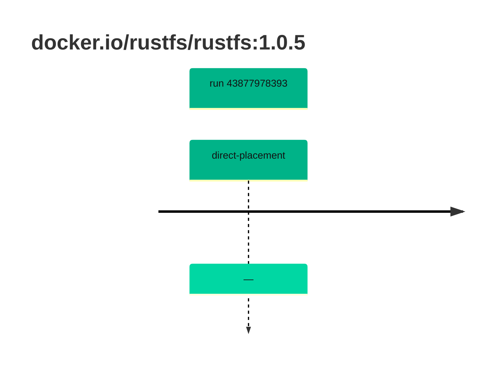

## rustfs-1 · docker.io/rustfs/rustfs:1.0.5

`sha256:b81d16a90ee25bd9511280127ca1471788c6e874cf0f0da759645f46b2dc1d74`

| ts | run | state | reason | ruleset | report | details |
| --- | --- | --- | --- | --- | --- | --- |
| 2026-11-16T13:44:04Z | [43877978393](https://github.com/trivoallan/base-images/actions/runs/43877978393) | direct-placement | — | sha256:0936ffb81cdaa3596af399bfa54a5c6b9171416996ea31b39bc77dab6a8c1585 | `results/reports/rustfs-1/sha256:b81d16a90ee25bd9511280127ca1471788c6e874cf0f0da759645f46b2dc1d74/43877978393-1.md` |  |

---

<!-- regis -->
# docker.io/rustfs/rustfs:sha256:b81d16a90ee25bd9511280127ca1471788c6e874cf0f0da759645f46b2dc1d74

## 🏷️ Placement direct · 100/100

**6/6 rules · all pass ✓**

**Analysis date:** 2026-11-16T13:43:57.085861+00:00

## Playbook results

| Playbook | Verdict | Failing rules |
| --- | --- | --- |
| Image copiée | 🏷️ Placement direct · 100/100 | 0 |
