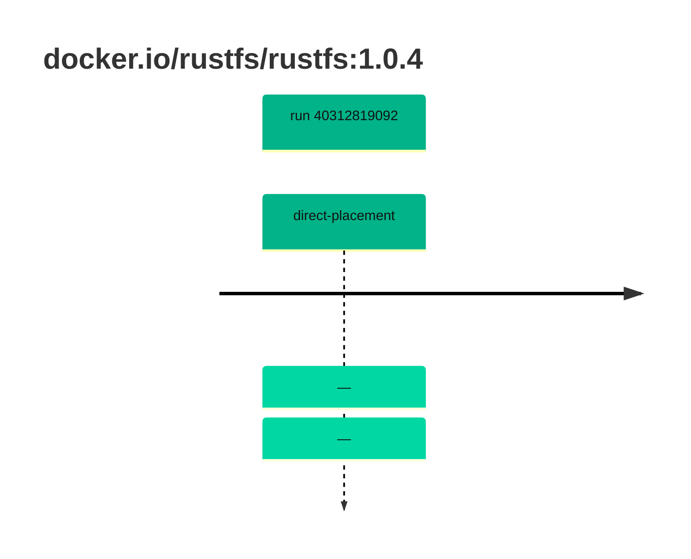

## rustfs-1 · docker.io/rustfs/rustfs:1.0.4

`sha256:ed9210d6411d77ffceb70d94b964a3cb7d225983368bc25bebe01e995293dcc2`

| ts | run | state | reason | ruleset | report | details |
| --- | --- | --- | --- | --- | --- | --- |
| 2026-10-26T11:16:44Z | [40312819092](https://github.com/trivoallan/base-images/actions/runs/40312819092) | direct-placement | — | sha256:0936ffb81cdaa3596af399bfa54a5c6b9171416996ea31b39bc77dab6a8c1585 | `results/reports/rustfs-1/sha256:ed9210d6411d77ffceb70d94b964a3cb7d225983368bc25bebe01e995293dcc2/40312819092-1.md` |  |
| 2026-10-26T11:18:09Z | [40312819092](https://github.com/trivoallan/base-images/actions/runs/40312819092) | direct-placement | — | sha256:0936ffb81cdaa3596af399bfa54a5c6b9171416996ea31b39bc77dab6a8c1585 |  | placed: sha256:db228176696408ddb23a713acf66c968c55d7a062d38e33ef973766edcc69bd9 |

---

<!-- regis -->
# docker.io/rustfs/rustfs:sha256:ed9210d6411d77ffceb70d94b964a3cb7d225983368bc25bebe01e995293dcc2

## 🏷️ Placement direct · 100/100

**6/6 rules · all pass ✓**

**Analysis date:** 2026-10-26T11:16:44.018202+00:00

## Playbook results

| Playbook | Verdict | Failing rules |
| --- | --- | --- |
| Image copiée | 🏷️ Placement direct · 100/100 | 0 |
