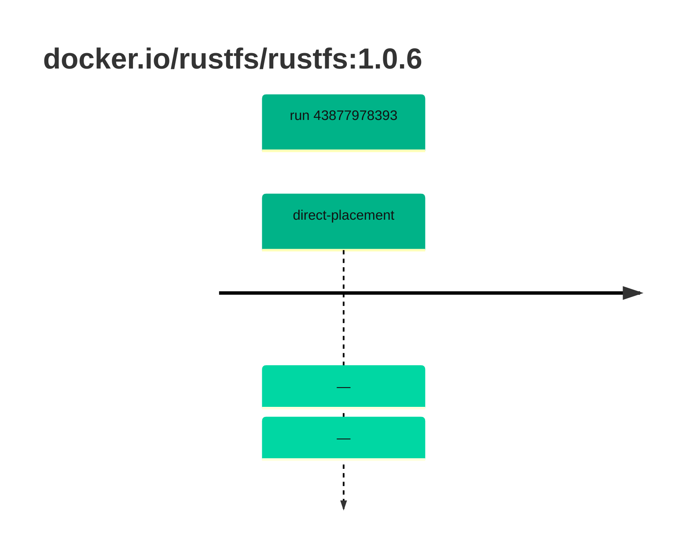

## rustfs-1 · docker.io/rustfs/rustfs:1.0.6

`sha256:ee717072290bec9b11abfc0365f8310b00df1cd9b3639943edae47bdef05044a`

| ts | run | state | reason | ruleset | report | details |
| --- | --- | --- | --- | --- | --- | --- |
| 2026-11-16T13:44:19Z | [43877978393](https://github.com/trivoallan/base-images/actions/runs/43877978393) | direct-placement | — | sha256:0936ffb81cdaa3596af399bfa54a5c6b9171416996ea31b39bc77dab6a8c1585 | `results/reports/rustfs-1/sha256:ee717072290bec9b11abfc0365f8310b00df1cd9b3639943edae47bdef05044a/43877978393-1.md` |  |
| 2026-11-16T13:45:45Z | [43877978393](https://github.com/trivoallan/base-images/actions/runs/43877978393) | direct-placement | — | sha256:0936ffb81cdaa3596af399bfa54a5c6b9171416996ea31b39bc77dab6a8c1585 |  | placed: sha256:501d344431d8af89194820a562eb42e320d7e742699328ec3d0c9e31932e0140 |

---

<!-- regis -->
# docker.io/rustfs/rustfs:sha256:ee717072290bec9b11abfc0365f8310b00df1cd9b3639943edae47bdef05044a

## 🏷️ Placement direct · 100/100

**6/6 rules · all pass ✓**

**Analysis date:** 2026-11-16T13:44:18.543571+00:00

## Playbook results

| Playbook | Verdict | Failing rules |
| --- | --- | --- |
| Image copiée | 🏷️ Placement direct · 100/100 | 0 |
