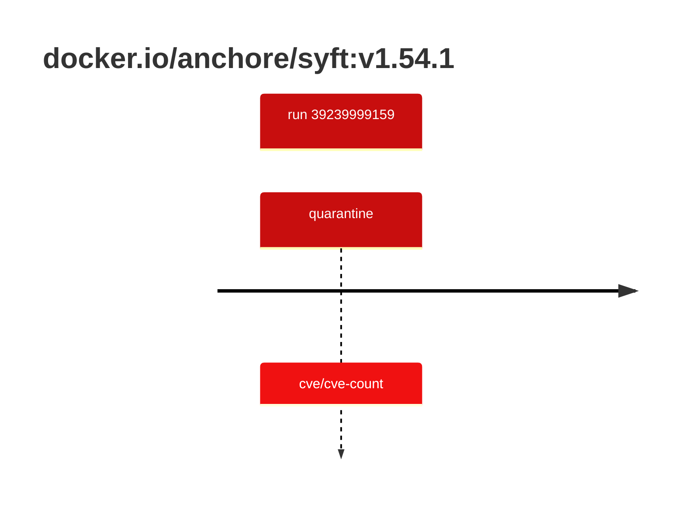

## syft-1 · docker.io/anchore/syft:v1.54.1

`sha256:3eb5379ba7b409c3f4069b686110527af0c47df993fa5c10d13e7cf34f49b1aa`

| ts | run | state | reason | ruleset | report | details |
| --- | --- | --- | --- | --- | --- | --- |
| 2026-10-19T11:01:11Z | [39239999159](https://github.com/trivoallan/base-images/actions/runs/39239999159) | quarantine | cve/cve-count | sha256:0936ffb81cdaa3596af399bfa54a5c6b9171416996ea31b39bc77dab6a8c1585 | `results/reports/syft-1/sha256:3eb5379ba7b409c3f4069b686110527af0c47df993fa5c10d13e7cf34f49b1aa/39239999159-1.md` |  |

---

<!-- regis -->
# docker.io/anchore/syft:sha256:3eb5379ba7b409c3f4069b686110527af0c47df993fa5c10d13e7cf34f49b1aa

## 🏷️ Quarantaine · 67/100

**4/6 rules · 2 failed · worst: 🟥 critical**

| | Rule | Level | Result |
| --- | --- | --- | --- |
| ✗ | cve-critical | critical | Image has 5 critical CVEs (max allowed: 0). |
| ✗ | cve-high | warning | Image has 24 high CVEs (max allowed: 10). |

**Analysis date:** 2026-10-19T11:01:11.436067+00:00

## Playbook results

| Playbook | Verdict | Failing rules |
| --- | --- | --- |
| Image copiée | 🏷️ Quarantaine · 67/100 | 2 |
