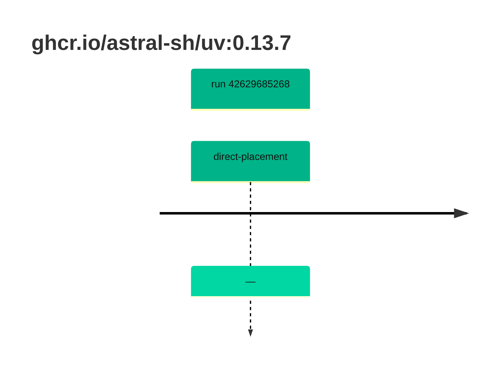

## uv-0 · ghcr.io/astral-sh/uv:0.13.7

`sha256:96f40d3904aad8d0bd010539001d36c8e2188b981e1334471a90c4a1d93bb490`

| ts | run | state | reason | ruleset | report | details |
| --- | --- | --- | --- | --- | --- | --- |
| 2026-11-09T14:01:46Z | [42629685268](https://github.com/trivoallan/base-images/actions/runs/42629685268) | direct-placement | — | sha256:0936ffb81cdaa3596af399bfa54a5c6b9171416996ea31b39bc77dab6a8c1585 | `results/reports/uv-0/sha256:96f40d3904aad8d0bd010539001d36c8e2188b981e1334471a90c4a1d93bb490/42629685268-1.md` |  |

---

<!-- regis -->
# ghcr.io/astral-sh/uv:sha256:96f40d3904aad8d0bd010539001d36c8e2188b981e1334471a90c4a1d93bb490

## 🏷️ Placement direct · 100/100

**6/6 rules · all pass ✓**

**Analysis date:** 2026-11-09T14:01:38.587740+00:00

## Playbook results

| Playbook | Verdict | Failing rules |
| --- | --- | --- |
| Image copiée | 🏷️ Placement direct · 100/100 | 0 |
