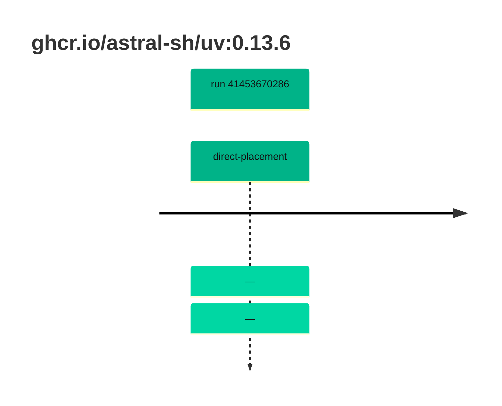

## uv-0 · ghcr.io/astral-sh/uv:0.13.6

`sha256:af22a52f5eafef3d78e551599d405c02df61919d18028f0cea8eda93bc9986d0`

| ts | run | state | reason | ruleset | report | details |
| --- | --- | --- | --- | --- | --- | --- |
| 2026-11-02T13:37:25Z | [41453670286](https://github.com/trivoallan/base-images/actions/runs/41453670286) | direct-placement | — | sha256:0936ffb81cdaa3596af399bfa54a5c6b9171416996ea31b39bc77dab6a8c1585 | `results/reports/uv-0/sha256:af22a52f5eafef3d78e551599d405c02df61919d18028f0cea8eda93bc9986d0/41453670286-1.md` |  |
| 2026-11-02T13:38:54Z | [41453670286](https://github.com/trivoallan/base-images/actions/runs/41453670286) | direct-placement | — | sha256:0936ffb81cdaa3596af399bfa54a5c6b9171416996ea31b39bc77dab6a8c1585 |  | placed: sha256:5484b7be8d8bf6eba92117b0f9d4163fb3b6b0b3010da6f33d9054af262973d1 |

---

<!-- regis -->
# ghcr.io/astral-sh/uv:sha256:af22a52f5eafef3d78e551599d405c02df61919d18028f0cea8eda93bc9986d0

## 🏷️ Placement direct · 100/100

**6/6 rules · all pass ✓**

**Analysis date:** 2026-11-02T13:37:21.384566+00:00

## Playbook results

| Playbook | Verdict | Failing rules |
| --- | --- | --- |
| Image copiée | 🏷️ Placement direct · 100/100 | 0 |
