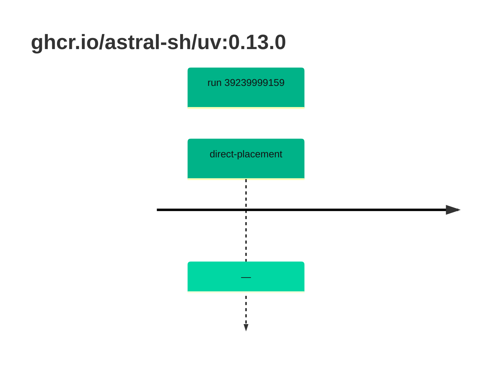

## uv-0 · ghcr.io/astral-sh/uv:0.13.0

`sha256:cdc6093146eb3ff6a40107b38f008b789e050e77ad87865e381d9917da55a168`

| ts | run | state | reason | ruleset | report | details |
| --- | --- | --- | --- | --- | --- | --- |
| 2026-10-19T11:01:38Z | [39239999159](https://github.com/trivoallan/base-images/actions/runs/39239999159) | direct-placement | — | sha256:0936ffb81cdaa3596af399bfa54a5c6b9171416996ea31b39bc77dab6a8c1585 | `results/reports/uv-0/sha256:cdc6093146eb3ff6a40107b38f008b789e050e77ad87865e381d9917da55a168/39239999159-1.md` |  |

---

<!-- regis -->
# ghcr.io/astral-sh/uv:sha256:cdc6093146eb3ff6a40107b38f008b789e050e77ad87865e381d9917da55a168

## 🏷️ Placement direct · 100/100

**6/6 rules · all pass ✓**

**Analysis date:** 2026-10-19T11:01:37.612280+00:00

## Playbook results

| Playbook | Verdict | Failing rules |
| --- | --- | --- |
| Image copiée | 🏷️ Placement direct · 100/100 | 0 |
