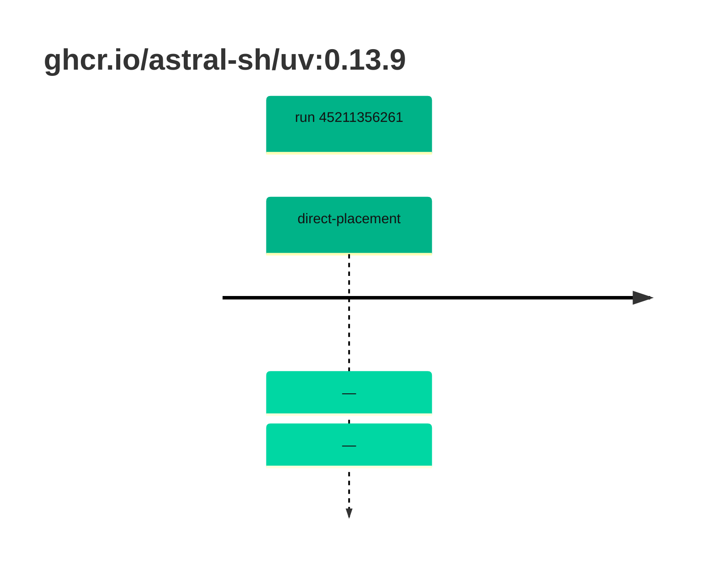

## uv-0 · ghcr.io/astral-sh/uv:0.13.9

`sha256:d3b601f0c7b118bc1753febf7c41cc80981df678445e0254284eecf84db79a7d`

| ts | run | state | reason | ruleset | report | details |
| --- | --- | --- | --- | --- | --- | --- |
| 2026-11-23T16:08:16Z | [45211356261](https://github.com/trivoallan/base-images/actions/runs/45211356261) | direct-placement | — | sha256:0936ffb81cdaa3596af399bfa54a5c6b9171416996ea31b39bc77dab6a8c1585 | `results/reports/uv-0/sha256:d3b601f0c7b118bc1753febf7c41cc80981df678445e0254284eecf84db79a7d/45211356261-1.md` |  |
| 2026-11-23T16:10:07Z | [45211356261](https://github.com/trivoallan/base-images/actions/runs/45211356261) | direct-placement | — | sha256:0936ffb81cdaa3596af399bfa54a5c6b9171416996ea31b39bc77dab6a8c1585 |  | placed: sha256:1a692628c47631ec1755751c0250eb4b3399afd4304b6d0ac6e05f9563c87982 |

---

<!-- regis -->
# ghcr.io/astral-sh/uv:sha256:d3b601f0c7b118bc1753febf7c41cc80981df678445e0254284eecf84db79a7d

## 🏷️ Placement direct · 100/100

**6/6 rules · all pass ✓**

**Analysis date:** 2026-11-23T16:08:15.464442+00:00

## Playbook results

| Playbook | Verdict | Failing rules |
| --- | --- | --- |
| Image copiée | 🏷️ Placement direct · 100/100 | 0 |
