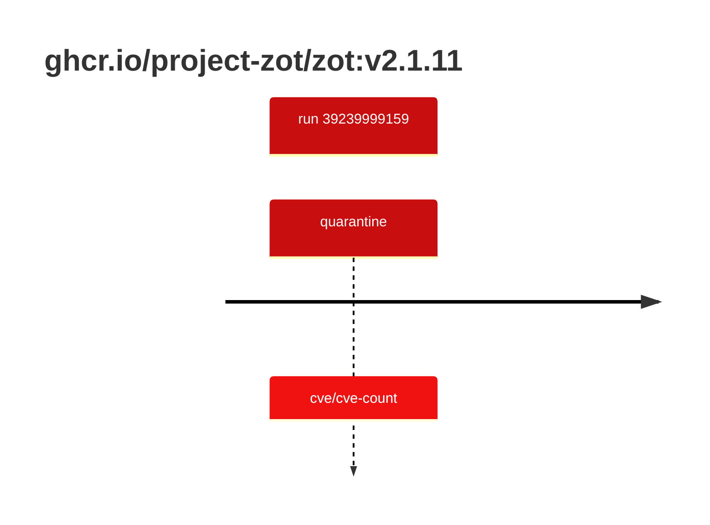

## zot-2 · ghcr.io/project-zot/zot:v2.1.11

`sha256:3173a595c5bbb62dcce0bc13c6d86d4dbfbaae3167fb0dacc79d0b50eb494783`

| ts | run | state | reason | ruleset | report | details |
| --- | --- | --- | --- | --- | --- | --- |
| 2026-10-19T11:05:23Z | [39239999159](https://github.com/trivoallan/base-images/actions/runs/39239999159) | quarantine | cve/cve-count | sha256:0936ffb81cdaa3596af399bfa54a5c6b9171416996ea31b39bc77dab6a8c1585 | `results/reports/zot-2/sha256:3173a595c5bbb62dcce0bc13c6d86d4dbfbaae3167fb0dacc79d0b50eb494783/39239999159-1.md` |  |

---

<!-- regis -->
# ghcr.io/project-zot/zot:sha256:3173a595c5bbb62dcce0bc13c6d86d4dbfbaae3167fb0dacc79d0b50eb494783

## 🏷️ Quarantaine · 50/100

**3/6 rules · 3 failed · worst: 🟥 critical**

| | Rule | Level | Result |
| --- | --- | --- | --- |
| ✗ | cve-critical | critical | Image has 22 critical CVEs (max allowed: 0). |
| ✗ | cve-high | warning | Image has 140 high CVEs (max allowed: 10). |
| ✗ | freshness | warning | Image is older than 90 days (332 days). |

**Analysis date:** 2026-10-19T11:05:23.090170+00:00

## Playbook results

| Playbook | Verdict | Failing rules |
| --- | --- | --- |
| Image copiée | 🏷️ Quarantaine · 50/100 | 3 |
