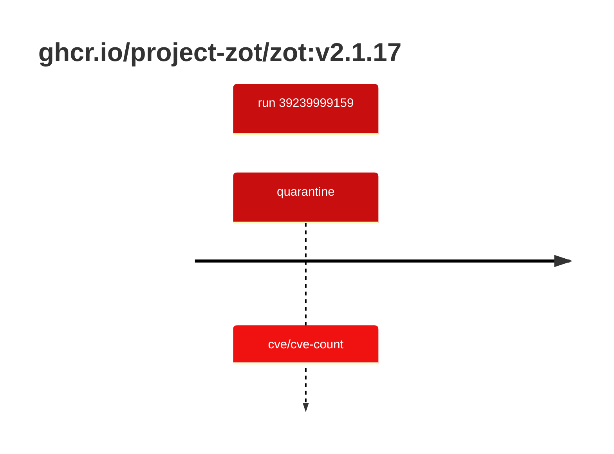

## zot-2 · ghcr.io/project-zot/zot:v2.1.17

`sha256:48b0c11c8c61a07246e047f22e02aad615816683fd8d8073b2862fb7ed0a3cc0`

| ts | run | state | reason | ruleset | report | details |
| --- | --- | --- | --- | --- | --- | --- |
| 2026-10-19T11:06:32Z | [39239999159](https://github.com/trivoallan/base-images/actions/runs/39239999159) | quarantine | cve/cve-count | sha256:0936ffb81cdaa3596af399bfa54a5c6b9171416996ea31b39bc77dab6a8c1585 | `results/reports/zot-2/sha256:48b0c11c8c61a07246e047f22e02aad615816683fd8d8073b2862fb7ed0a3cc0/39239999159-1.md` |  |

---

<!-- regis -->
# ghcr.io/project-zot/zot:sha256:48b0c11c8c61a07246e047f22e02aad615816683fd8d8073b2862fb7ed0a3cc0

## 🏷️ Quarantaine · 50/100

**3/6 rules · 3 failed · worst: 🟥 critical**

| | Rule | Level | Result |
| --- | --- | --- | --- |
| ✗ | cve-critical | critical | Image has 12 critical CVEs (max allowed: 0). |
| ✗ | cve-high | warning | Image has 57 high CVEs (max allowed: 10). |
| ✗ | freshness | warning | Image is older than 90 days (154 days). |

**Analysis date:** 2026-10-19T11:06:31.952865+00:00

## Playbook results

| Playbook | Verdict | Failing rules |
| --- | --- | --- |
| Image copiée | 🏷️ Quarantaine · 50/100 | 3 |
