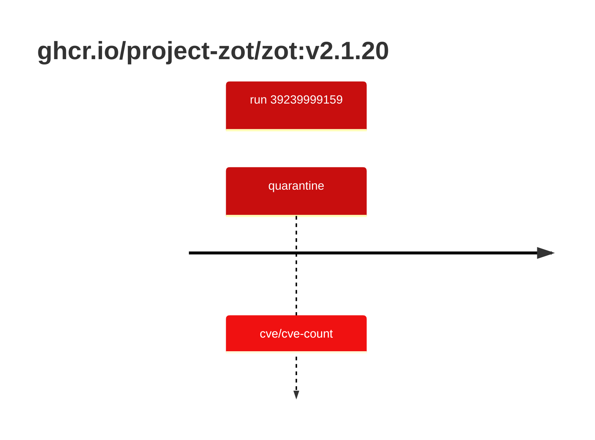

## zot-2 · ghcr.io/project-zot/zot:v2.1.20

`sha256:542e25be4d32e7879c0cfad93492a93c81b1e059cbd2d30d485d4bd567318234`

| ts | run | state | reason | ruleset | report | details |
| --- | --- | --- | --- | --- | --- | --- |
| 2026-10-19T11:07:07Z | [39239999159](https://github.com/trivoallan/base-images/actions/runs/39239999159) | quarantine | cve/cve-count | sha256:0936ffb81cdaa3596af399bfa54a5c6b9171416996ea31b39bc77dab6a8c1585 | `results/reports/zot-2/sha256:542e25be4d32e7879c0cfad93492a93c81b1e059cbd2d30d485d4bd567318234/39239999159-1.md` |  |

---

<!-- regis -->
# ghcr.io/project-zot/zot:sha256:542e25be4d32e7879c0cfad93492a93c81b1e059cbd2d30d485d4bd567318234

## 🏷️ Quarantaine · 67/100

**4/6 rules · 2 failed · worst: 🟥 critical**

| | Rule | Level | Result |
| --- | --- | --- | --- |
| ✗ | cve-critical | critical | Image has 3 critical CVEs (max allowed: 0). |
| ✗ | cve-high | warning | Image has 35 high CVEs (max allowed: 10). |

**Analysis date:** 2026-10-19T11:07:06.467031+00:00

## Playbook results

| Playbook | Verdict | Failing rules |
| --- | --- | --- |
| Image copiée | 🏷️ Quarantaine · 67/100 | 2 |
