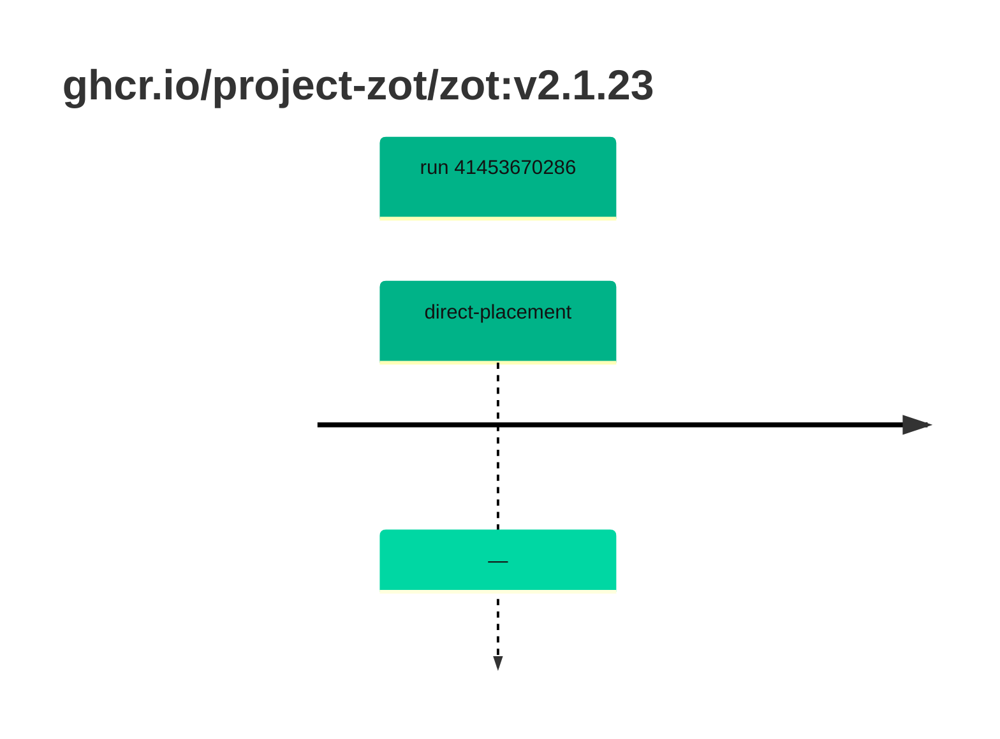

## zot-2 · ghcr.io/project-zot/zot:v2.1.23

`sha256:9d3de83ac2099e6f4843045b4c9b65b7e8baf40f92d28f54906dee9d4d390fd7`

| ts | run | state | reason | ruleset | report | details |
| --- | --- | --- | --- | --- | --- | --- |
| 2026-11-02T13:39:55Z | [41453670286](https://github.com/trivoallan/base-images/actions/runs/41453670286) | direct-placement | — | sha256:0936ffb81cdaa3596af399bfa54a5c6b9171416996ea31b39bc77dab6a8c1585 | `results/reports/zot-2/sha256:9d3de83ac2099e6f4843045b4c9b65b7e8baf40f92d28f54906dee9d4d390fd7/41453670286-1.md` |  |

---

<!-- regis -->
# ghcr.io/project-zot/zot:sha256:9d3de83ac2099e6f4843045b4c9b65b7e8baf40f92d28f54906dee9d4d390fd7

## 🏷️ Placement direct · 100/100

**6/6 rules · all pass ✓**

**Analysis date:** 2026-11-02T13:39:54.660483+00:00

## Playbook results

| Playbook | Verdict | Failing rules |
| --- | --- | --- |
| Image copiée | 🏷️ Placement direct · 100/100 | 0 |
